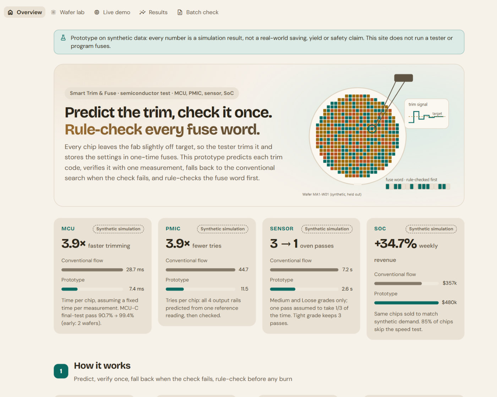
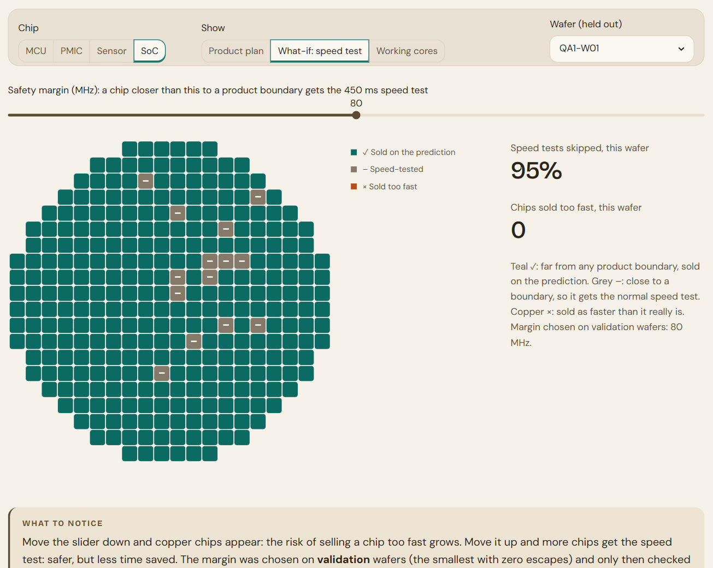
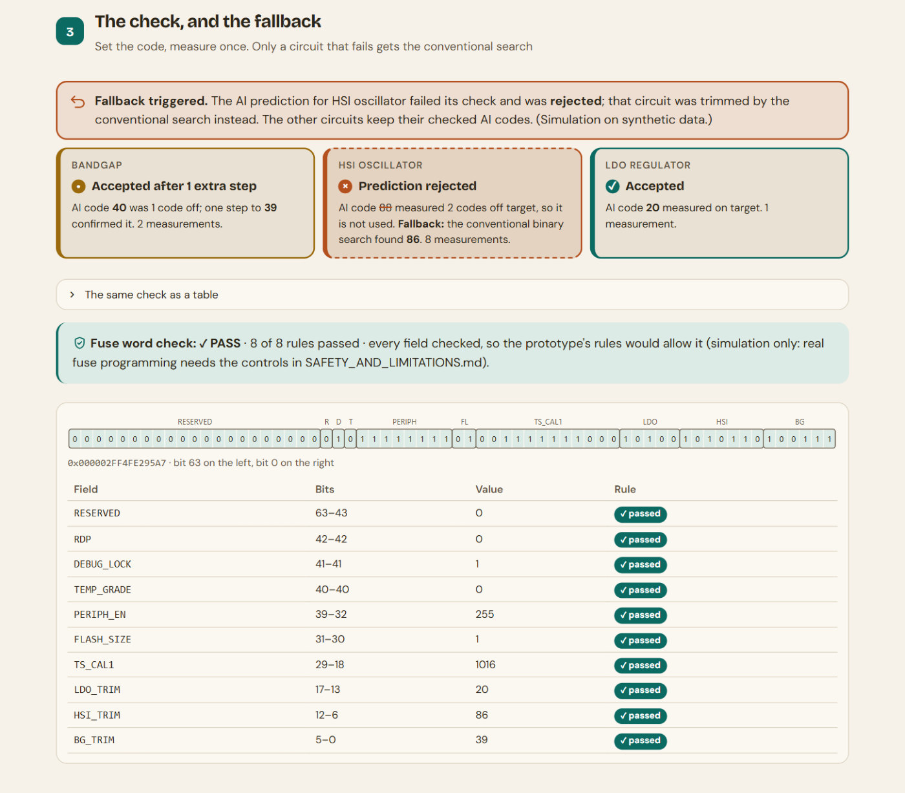
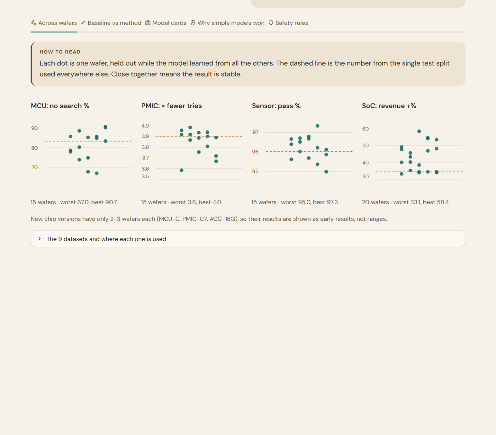
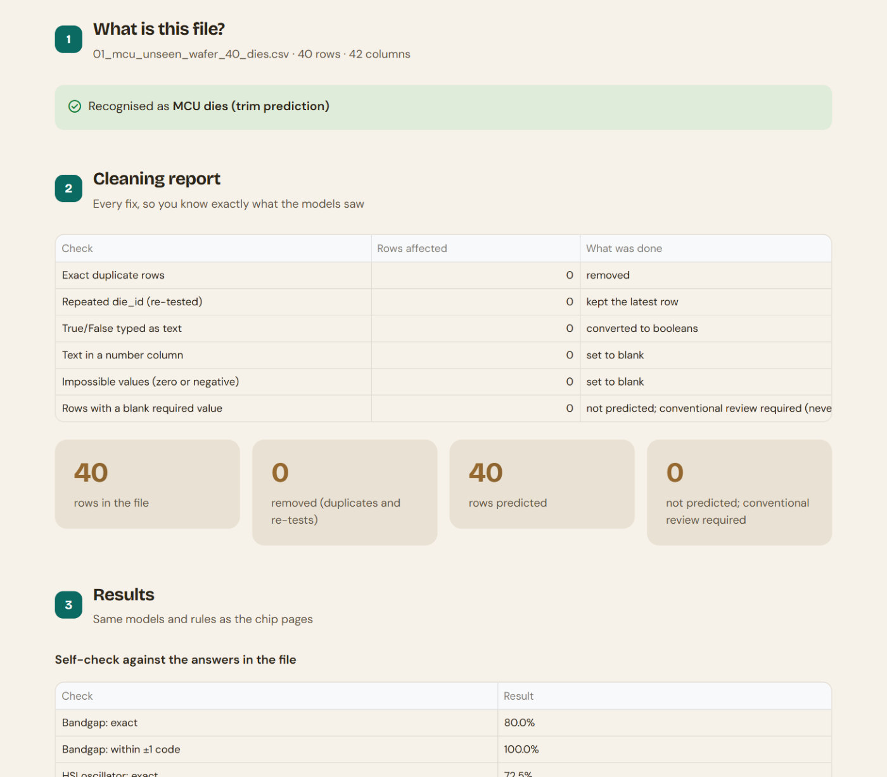

# Smart Trim & Fuse

**AI-assisted trimming and rule-checked fusing for derivative chips: MCU, power chip (PMIC), sensor and SoC.**

> **Prototype on synthetic data.** Every number below is a simulation result on the synthetic dataset provided with
> the task, not a real-world saving, yield or safety claim. The site does not run a tester or program fuses.
> See [SAFETY_AND_LIMITATIONS.md](SAFETY_AND_LIMITATIONS.md).

**Live demo:** _link added after deployment_ · **Run it yourself:** [RUN_GUIDE.md](RUN_GUIDE.md) ·
**Report:** [Deliverables/Smart_Trim_Fuse_Report.pdf](Deliverables/Smart_Trim_Fuse_Report.pdf) ·
**Slides:** [Deliverables/Smart_Trim_Fuse_Presentation.pptx](Deliverables/Smart_Trim_Fuse_Presentation.pptx)

The report also describes a Power BI dashboard; it is kept locally and is not part of this repository.



## The problem

Every analog chip leaves the fab slightly off target, so the tester **trims** it: a trial-and-error binary search,
about 20 measurements for one microcontroller. The result is then burned into **one-time fuses**, which can't be
undone.

## The idea: predict, verify once, fall back, rule-check

1. **Measure:** readings the tester already takes (untrimmed values, process monitors, die position).
2. **Predict:** a model trained on earlier wafers proposes each trim code. No search loop.
3. **Verify once:** set the code and measure once. If the check fails, or an input is outside the training range,
   the chip **falls back to the conventional search**, so a wrong prediction costs time, not a wrong code.
4. **Rule-check the fuse word:** fixed rules (not AI) check all 64 bits: product settings, security locks and the
   per-die trim and TS_CAL1 fields. **PASS** only when every rule passes for an identified die; otherwise
   **REVIEW** or **BLOCK**.

## Results (synthetic simulation)

Model results (MCU, MCU-C, power chip, sensor, SoC speed test) are measured on wafers the models never saw, and
re-checked with each wafer held out in turn. The SoC revenue plan and the fuse-word checks train nothing, so they use
all the data. Every number, with its dataset, split, seed, model and definition, is in
[RESULTS_SOURCE_OF_TRUTH.md](RESULTS_SOURCE_OF_TRUTH.md).

| Chip | Result | Range across wafers |
|---|---|---|
| MCU | Trimming **28.7 → 7.4 ms per chip (3.9×)**; **83%** of chips need no search | speed-up 2.9–4.7×; no search 67–91% |
| MCU-C | Packaging-drift fix: final-test pass **90.7% → 99.4%** | 99.0–99.8% (only 2 wafers: early result) |
| Power chip | **44.7 → 11.5 tries (3.9×)** from one reference reading; **79%** need no search | 3.6–4.0×; 3.5–3.9× on versions never trained on |
| Sensor | **3 oven passes → 1** for Medium / Loose grades (7.2 → 2.6 s); 96% of Medium chips in limits | 95–97% |
| SoC | **+34.7% weekly revenue** from the same chips (optimiser vs synthetic demand); **85%** skip the speed test, 0 of 1,540 sold too fast | +33% to +58% per wafer |
| SoC Vmin | Worst-core minimum voltage predicted from monitors with **4.2 mV** typical error (baseline 27 mV); a **25 mV** margin left 0 of 1,540 chips under-predicted | 3.8–4.5 mV |
| SoC AVS | Chips that skip the speed test get their voltage bin from the prediction: **0 of 1,306** given less voltage than they need (34% exact bin, 66% higher, mean +12.7 mV) | – |
| MCU temp. sensor | 110 °C calibration point predicted for MCU-A/B (trained on MCU-C, the only version tested hot): **3.0 → 0.82 °C** typical error, 95% within ±2 °C | 0.78–0.87 °C over 18 wafers |
| Fuse words | **406 / 406** injected errors caught, **0** false alarms, every field checked | – |

Time figures assume a fixed time per measurement or oven pass; the SoC gain depends on 3 rows of synthetic prices and
demand. Details and caveats are in the source-of-truth table.

## Models, and why

| Model | Used for | Why |
|---|---|---|
| Random Forest | MCU trim codes (bandgap, clock, LDO), PMIC reference | Handles the clock's non-linear pattern; beat XGBoost, LightGBM and a neural net |
| Ridge regression | PMIC output rails, sensor temperature behaviour, SoC core speed, SoC Vmin, MCU temperature sensor | Near-linear physics: the simple model won and carried over to new chip versions |
| Transfer learning (gradient boosting) | MCU-C packaging drift | Learned on MCU-A, fine-tuned with only 50 MCU-C chips |
| Fixed rules | Fuse words, customer OTP settings, PMIC hidden defects | A fuse can't be undone: exact answers (rules 100% vs ML 96–98.5%) |
| Integer optimiser (ILP) | SoC product plan | Matching chips to demand has one exact best answer |
| Exact repair solver | SoC memory repair | 17 more arrays repaired than greedy |

Tried and not used: XGBoost / LightGBM (no better), neural nets, GNN / kriging, GAN augmentation, RNN, reinforcement
learning (none beat the simple models; see notebook 05).

## The website

A Streamlit app with five pages. All models are the files saved by the notebooks; nothing is retrained in the app.

| | |
|---|---|
|  |  |
| **Wafer lab:** every die on a held-out wafer, with what-if sliders | **Live demo:** one chip in 4 steps; a tricky chip is rejected and falls back |
|  |  |
| **Results:** wafer-by-wafer ranges, baselines, model cards | **Batch check:** upload a CSV; it is recognised, cleaned and checked |

```bash
pip install -r requirements.txt
```

```bash
streamlit run "Smart Trim Fuse/app/streamlit_app.py"
```

Python 3.13; every package is pinned. Full clean-install steps, the checks and the notebook order are in
[RUN_GUIDE.md](RUN_GUIDE.md).

## Repository layout

| Folder / file | Contents |
|---|---|
| `Smart Trim Fuse/` | The website: `app/` (5 pages), `src/` (logic, rules, optimiser), `models/` (saved models), `data/` (9 CSVs), `tests/` (43 checks) |
| `Colab Notebook/` | 9 notebooks, run in order 00 → 08, plus the 9 CSVs they read |
| `Demo/` | 13 test CSVs for the Batch check page (files 10-13 mix healthy and really defective dies), with `expected_results.csv` |
| `AI Trim & Fuse/Dataset/` | The synthetic dataset as provided, with its data dictionary and generator |
| `Deliverables/` | Presentation (PPTX) and report (DOCX + PDF) |
| `docs/` | Screenshots and [PROJECT_NOTES.md](docs/PROJECT_NOTES.md): technical notes on the approach, validation and controls |
| `RESULTS_SOURCE_OF_TRUTH.md` / `.csv` | Every headline number and its definition |
| `RUN_GUIDE.md` · `SAFETY_AND_LIMITATIONS.md` · `PROJECT_MAP.md` | How to run it, its limits, which files are canonical |

### Notebooks

| Notebook | What it does | Saves |
|---|---|---|
| `00_Data_Overview_Cleaning_EDA` | Overview, cleaning and charts for all 9 datasets | `cleaned/` |
| `01_MCU_Trim_Fuse` | MCU trim models (wafer split, baselines, 6 model types, tuning) and the MCU-C drift fix | `trim_models.joblib` |
| `02_PMIC_Trim_OTP` | Power-chip rails from one reading, current sense, OTP rules, hidden defects | `pmic_models.joblib` |
| `03_Sensor_Calibration` | Hot and cold behaviour from a 25 °C test, by product grade | `sensor_models.joblib` |
| `04_SoC_Binning_Repair` | Core speed, product rules, demand optimiser, memory repair | `soc_models.joblib` |
| `05_Advanced_Methods_Check` | GNN, GAN, RNN, RL and others: what didn't help, and why | – |
| `06_Evaluation_and_Deployment` | Each wafer held out in turn, validated SoC margin, fallback and monitoring, model cards | `evaluation_06.json` |
| `07_SoC_Vmin_Prediction` | Worst-core Vmin from monitors: baselines vs models, safety margin chosen on validation wafers, every wafer held out in turn | `vmin_models.joblib` |
| `08_MCU_Temperature_Sensor_Calibration` | The 110 °C sensor point for MCU-A/B, learned on MCU-C: fixed-slope baseline vs models, every wafer, extrapolation check | `tsense_models.joblib` |

## Checks

```bash
cd "Smart Trim Fuse"
```

```bash
python -m unittest discover -s tests -v
```

43 checks: fuse and OTP rules, file recognition and cleaning, the wafer-grouped split, every Demo file, every headline
number recomputed from the saved models, identical data copies, and colour contrast in all four themes.

## Limits

Synthetic data only, so the size of every gain still has to be confirmed on real wafers, first in shadow mode beside
the conventional flow. No ISO 26262 or other compliance is claimed, and the code must not be used to program real
fuses. See [SAFETY_AND_LIMITATIONS.md](SAFETY_AND_LIMITATIONS.md).

**Author:** Darshan Masur
